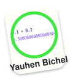
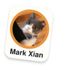
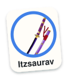

# py-harness

[](./LICENSE)
[](https://pypi.org/project/py-harness-cli/)
[](https://github.com/YauhenBichel/py-harness/actions/workflows/ci.yml)
[](https://yauhenbichel.github.io/py-harness/)
[](https://yauhenbichel.github.io/py-harness/)
[](https://github.com/YauhenBichel/py-harness#contributors)

py-harness is a command-line tool that runs a small local coding model (through Ollama) on one Python folder, so you can ask questions about code, write tests, fix bugs and add small functions without a cloud API.

Four jobs on your laptop: **ask**, **write a test**, **fix a bug**, **add
one small function**. Only touches the folder you point at. Daily work
is `py-harness` plus Ollama `llama3.1:8b`. Not everyday-ready.
Site: [yauhenbichel.github.io/py-harness](https://yauhenbichel.github.io/py-harness/).

## Run it

```bash
python3 -m venv .venv && source .venv/bin/activate
pip install py-harness-cli
```

The command is `py-harness`. The PyPI name is `py-harness-cli` because
`py-harness` collides with another package. Do not `pip install
py-harness` or `pip install pyharness`.

Sample project — clone, then `cd demo/orders`. Do not `brief` this
repository.

```bash
git clone https://github.com/YauhenBichel/py-harness.git
cd py-harness/demo/orders
py-harness brief
py-harness ask  "what does compute_total return?"
py-harness run  "find the NameError and fix it"
```

Activate `.venv` in **every new terminal**. If the shell says
`command not found: py-harness`, it is not active. Daily work needs
`ollama pull llama3.1:8b`. From a clone,
`python3 scripts/run/install.py` is the editable install. Settings: [`.env.example`](./.env.example).

`ask` never writes. `run` writes, then runs the tests. The NameError
sample is built into the tool (no model). Another folder:
`py-harness ask ~/app "what does add return?"`.

[Start](https://yauhenbichel.github.io/py-harness/start/) ·
[Commands](https://yauhenbichel.github.io/py-harness/api/) ·
[Contributing](./CONTRIBUTING.md) ·
[Security](./SECURITY.md)

## What it prints

Two commands that need no model, run on the sample project `demo/orders` (installed from a clone at version 0.4.0; the PyPI release 0.3.1 prints the same):

```console
$ py-harness brief
10 Python and Markdown files, 3.3 KB in total.
Small enough that py-harness can read all of it, so you can ask about any part.

Files:
  README.md  1.0 KB
  src/__init__.py  68 B
  src/orders.py  467 B
  src/orders_controller.py  568 B
  src/orders_service.py  285 B
  src/render.py  193 B
  src/report.py  155 B
  src/util.py  67 B
  tests/__init__.py  0 B
  tests/test_orders.py  511 B

py-harness has 24 skills it can apply. It picks them from the wording of your task; you do not choose them.
$ py-harness run "find the NameError and fix it"
bound unique NameError typo (subtotl → subtotal) in src/orders.py. Tests passed.
```

The fix changes one line in `src/orders.py`: `return subtotl + (subtotl * TAX_RATE)` becomes `return subtotal + (subtotal * TAX_RATE)`. `ask` and most other `run` jobs need Ollama; their recorded sessions are in the pictures below.

## What it looks like


Replay: `asciinema play docs/media/pip-demo.cast`.
A longer session (8B ask): `docs/media/live-demo.gif`.
Full log: [Live demo](https://yauhenbichel.github.io/py-harness/live/).

**VS Code** — `py-harness editors vscode`, then Tasks: Run Task.


Replay: `asciinema play docs/media/vscode-demo.cast`.
[VS Code](https://yauhenbichel.github.io/py-harness/vscode/).

**Cursor** — `py-harness editors cursor --allow-writes`, then chat or Tasks.


Replay: `asciinema play docs/media/cursor-demo.cast`.
[Cursor](https://yauhenbichel.github.io/py-harness/cursor/).

## When to use it, and when not

Use it to try a local 8B model on a small Python project you do not want to send to a cloud service, with a harness that checks each change by running your tests. Do not use it as an everyday coding assistant (the scores above say it is not ready), on a large repository (a real 4,580-file repository wrote 1 / 12), or for languages other than Python.

## FAQ

### How do I run a local LLM on my Python project?

Install `py-harness-cli`, run `ollama pull llama3.1:8b`, then `py-harness ask "what does add return?"` in the project folder. See [Run it](#run-it).

### Does it send my code to the cloud?

Not by default. The default backend is a local Ollama server (or the one named in `OLLAMA_HOST`). Other backends can be chosen with `--engine`, so check which one you set. It reads and writes only the folder you point at.

### What can it change?

Only `.py`, `.pyi`, `.md`, `.toml`, `.yml`, `.yaml`, `.cfg`, `.ini` and `.json` files under the project folder, and it refuses secret file names. `ask` never writes.

### Why is the package called py-harness-cli?

The name `py-harness` on PyPI belongs to another project. The command is still `py-harness`.

### Do I need a GPU?

No. The sample commands above need no model at all. Daily work uses `llama3.1:8b` through Ollama on a laptop.

### How is it different from Aider or Continue?

Those are general coding assistants for many models and languages. py-harness is narrower: four jobs, Python only, a deterministic harness that decides what is written, and published measurements of where it fails.

## Scores

One laptop. 29 Aug–5 Sep 2026. **Not everyday-ready.**

| What I tried | Result |
| --- | --- |
| 0.5B as daily work | **0 / 4** vibe, **0 / 2** parse |
| Four Start commands on `demo/orders` | **0 / 4**, then **4 / 4** after the harness |
| Same bench, code must run | 8B **6–9 / 9**; 7B coder 7 / 9; 30B timeout |
| Same-night daily (write tests, clamp, sum × 3) | 8B **9 / 9**, 7B coder **7 / 9**. Keep the 8B |
| Extra 7B–8B on disk | 8192-warmed SWE daily clamp: first generate 180s. Not a score |
| A real repository (4,580 files) | reading works; writing **1 / 12** |

The long table: [Experiments](https://yauhenbichel.github.io/py-harness/investigations/experiments/).
Every score: [Results](https://yauhenbichel.github.io/py-harness/investigations/).
Which tags timed out: [Hub models](https://yauhenbichel.github.io/py-harness/investigations/hub-models/).

## Experiments

Every run since 24 September is filed by `scripts/measure/experiment.py` with its noise floor. All 14, every record: [docs/experiments](docs/experiments/) · [Hugging Face](https://huggingface.co/datasets/YauhenBichel/py-harness-intents/tree/main/experiments).

| Measured | Result |
| --- | --- |
| A local 30B on tiers 1–6 | **72 / 75** |
| Decision model vs regex, 30B, bug tiers | 30 / 30 both; it exposed three bug-fix faults, runs that never said done **16 → 0** |
| Decision model vs regex, 7B, bug tiers | **11 vs 6 / 30**, real; all of it one repair |
| Reading the 7B's diffs and JSON as turns | **15 / 30**, real +4; the next reading noise, floor 3 |
| `llama3.1:8b` on the GPU host | not measurable: word salad past ~500 prompt tokens |

## More

| If you want | Go here |
| --- | --- |
| What each folder is | [Folders](https://yauhenbichel.github.io/py-harness/tree/) |
| Tests | `PYTHONPATH=src python -m unittest discover -s tests -q` |
| 0.5B style prior | [YauhenBichel/python-vibe-0.5b](https://huggingface.co/YauhenBichel/python-vibe-0.5b) |
| Train / serve / API | [Commands](https://yauhenbichel.github.io/py-harness/api/) |
| A first issue | [good first issue](https://github.com/YauhenBichel/py-harness/labels/good%20first%20issue) |

Vulnerabilities: a **public** GitHub issue. Do not paste live keys.

---

## Contributors

Thank you to everyone who has helped py-harness.

<!-- readme: contributors,bots/- -start -->
<p align="center">
  <a href="https://github.com/YauhenBichel" title="Yauhen Bichel" aria-label="Yauhen Bichel"></a>
  <a href="https://github.com/xianjianlf2" title="Mark Xian" aria-label="Mark Xian"></a>
  <a href="https://github.com/ItzSaurav" title="Itzsaurav" aria-label="Itzsaurav"></a>
  <a href="https://github.com/svkzn" title="svkzn" aria-label="svkzn"></a>
  <a href="https://github.com/Aditya-233" title="Aditya" aria-label="Aditya"></a>
  <a href="https://github.com/kkkhs" title="Huangshuo Kuang" aria-label="Huangshuo Kuang"></a>
  <a href="https://github.com/be-student" title="송은우" aria-label="송은우"></a>
</p>
<!-- readme: contributors,bots/- -end -->

Filled from GitHub commits (bots omitted). [Contributor graph](https://github.com/YauhenBichel/py-harness/graphs/contributors) · [good first issue](https://github.com/YauhenBichel/py-harness/labels/good%20first%20issue) · [Action](https://github.com/YauhenBichel/readme-contributors)
